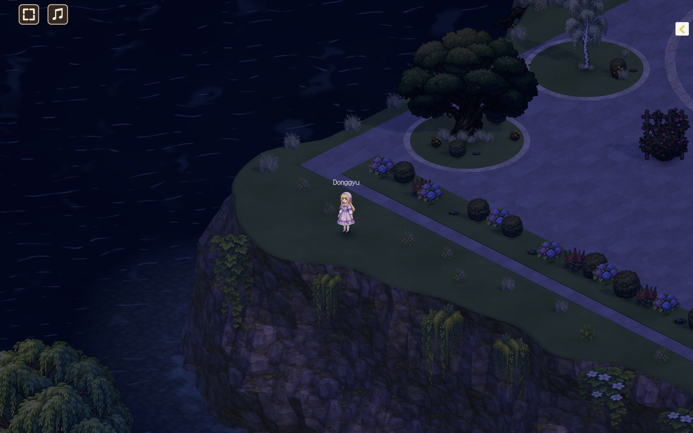
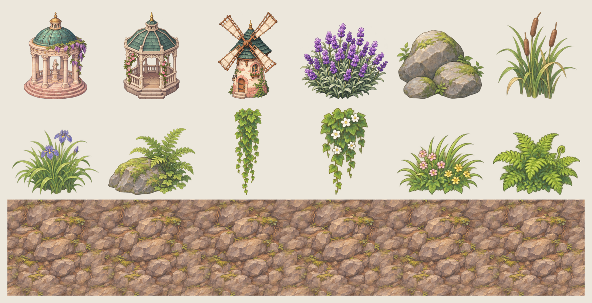

# dg-village

**아름다운 게임**을 목표로 하는 멀티플레이 게임입니다. 손으로 그린 듯한 2D 애니풍 캐릭터가 3D 물가 정원 마을 **Willow Court**를 함께 걷고 이야기합니다.



## 다운로드

[최신 릴리스](https://github.com/donggyushin/dg-village/releases/latest)에서 받을 수 있습니다.

- **Mac:** `dg-village-mac.zip` (Apple 서명·공증 완료)
- **Windows:** `dg-village-windows.zip`

## 지금 할 수 있는 것

- 계정 만들기, 로그인, 캐릭터 고르기, 채널 고르기
- 같은 맵의 다른 플레이어와 함께 걷기 (8방향 캐릭터, 실시간 위치 동기화)
- 맵 전체 채팅, 캐릭터 머리 위 말풍선
- 마지막 위치 저장과 복원
- 배경 음악과 볼륨 조절

## 보는 방식

- **레트로 2D + 현대 그래픽 (HD-2D 풍):** 캐릭터와 소품은 고해상도 2D 그림, 세계는 3D 블록 지형입니다. 실시간 조명, 그림자, URP 후처리를 함께 씁니다.
- **고정 쿼터뷰 카메라:** 회전하지 않는 Orthographic 카메라 (30°, 45°).
- **자연과 건축의 대비:** 광장, 계단, 석축은 반듯하게, 물가와 언덕 가장자리는 해안선과 바위 절벽으로 만들었습니다.

## 그림 에셋 — ChatGPT · PixelLab

맵의 건물과 소품 그림은 ChatGPT로, 캐릭터는 PixelLab으로 만들었습니다. 아래는 ChatGPT로 만든 그림의 일부입니다. 로툰다, 정자, 풍차, 라벤더, 물가 바위와 갈대, 절벽 덩굴, 들꽃, 그리고 맨 아래는 이어 붙여도 이음새가 없는 절벽 바위 텍스처입니다.



## 구성

```
dg-village/
├── unity/    # 게임 클라이언트 (Unity 6 · URP)
├── python/   # 게임 서버 (FastAPI · WebSocket · PostgreSQL)
└── deploy/   # 운영 서버 설정 (Docker Compose · Caddy)
```

| 영역 | 기술 |
|---|---|
| 클라이언트 | Unity `6000.6.6f1` · Universal Render Pipeline |
| 서버 | Python · FastAPI · SQLAlchemy · PostgreSQL, AWS Lightsail(시드니)에 배포 |
| 통신 | WebSocket 위의 JSON 메시지 (`docs/protocol.md`) |
| 플랫폼 | Mac · Windows 데스크톱 |

## 맵 생성기

물가와 절벽 지형은 Unity 에디터 메뉴로 다시 만들 수 있습니다.

- **DG Village → Waterfront → South bank coastline:** 남쪽 섬을 해안선 모양으로 만듭니다.
- **DG Village → Waterfront → East heights cliffs:** 동쪽 언덕의 바깥 가장자리를 절벽으로 만듭니다.
