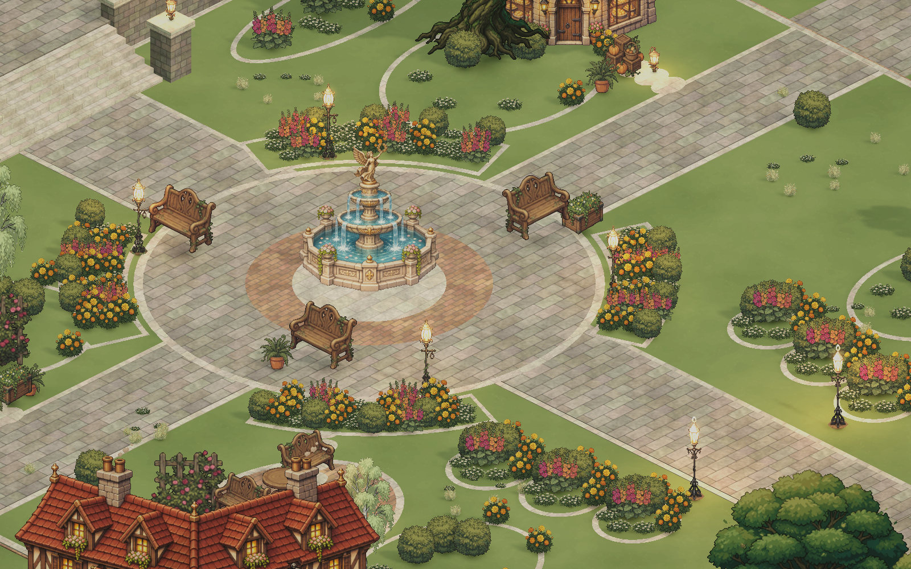
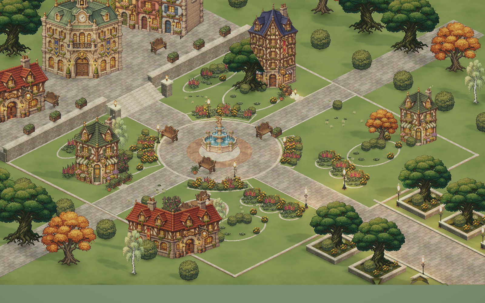

# Healing Square

2026-11-08 제작. 원본 SquareScene을 보존한 별도 정원 광장.

## 열기

Unity에서 `Assets/_Project/Scenes/SquareScene_Healing.unity`를 연다.
현재 Editor에는 이 Scene을 열어 두었다. 기존 Build Profiles와 로그인 후 Scene 이동 대상은 변경하지 않았다.
원본 `SquareScene.unity`, `SquareScene_Garden.unity`, 공유 Prefab과 Material은 변경하지 않았다.

## 구성

- 분수를 중심으로 원형 포장과 네 방향 진입로를 연결했다.
- 낮은 초승달 화단 네 개로 분수 시야를 확보하고, 큰 나무는 외곽으로 옮겼다.
- 벤치와 화분으로 휴식 공간, 찻집 앞 테이블과 디딤돌로 작은 차 마시는 공간을 구성했다.
- 꽃집 진열, 제과점 앞 소품, 테라스 정원과 남쪽 가로수 진입로를 연결했다.
- 원본 계단의 보행용 경사 Collider, 외곽 경계, 네트워크·카메라·UI·시간대 조명 로직은 유지했다.
- 분수와 건물의 접힌 바닥 Mesh가 새 포장에 가려지지 않도록 해당 Scene의 인스턴스 높이를 조정했다.

## 직접 편집할 위치

`Healing Garden • authored layout` 아래에 새 구성을 나누어 두었다.

1. `01 • Circular promenade`: 잔디, 보행로, 원형 포장
2. `02 • Cottage flower gardens`: 중심 꽃밭과 남쪽 식재
3. `03 • Reading & tea corners`: 광장 벤치와 조명
4. `04 • Canopy frame`: 외곽 나무
5. `05 • Shop life`: 찻집, 꽃집, 제과점 소품
6. `06 • Garden finishing`: 테라스 식재와 작은 풀 군락

원래 `VillageSquare`의 건물·기반·숲은 계속 사용한다. 교체한 중앙 화단과 가구는 비활성 상태로 남겨 두었으며, 남쪽 진입로의 원래 가로수와 조명만 활성 상태다.
낮은 꽃밭과 장식 포장은 통행 가능한 연출이다. 나무·벤치·큰 화분은 발밑 크기의 Collider를 사용한다.
Scene 수정은 Edit mode에서 한다.

## 새 에셋과 출처

- 새 Material, Mesh, 잔디 Texture2D, VolumeProfile: `Assets/_Project/Art/HealingSquare/`.
- 새 이미지 생성 서비스나 외부 다운로드는 사용하지 않았다.
- 꽃·나무·가구: 저장소의 `Assets/_Project/Art/Square/Props/` 기존 Prefab 재사용.
- 건물·분수: 기존 SquareScene의 City Prefab 인스턴스 재사용.
- 새 포장 Material: 프로젝트 `Materials/City/`의 기존 소재를 복제했다.
- 잔디 및 Mesh 생성: 기존 `SquareArtDirector.cs`의 로컬 생성 방식을 바탕으로 작성한 Editor 전용 `HealingSquareDirector.cs`.
- `HealingDaylight.asset`: 원래 VolumeProfile과 그 하위 컴포넌트를 각각 복제하여 조정했다. 원본 공유 Profile을 수정하지 않는다.
- 결과는 직렬화된 일반 Scene 및 에셋이다. 실행 시 생성 Script가 필요하지 않다.
- 생성 메뉴는 원본 Scene에서 새 결과 파일이 없을 때만 실행할 수 있다. 결과 Scene이 있으면 재생성을 거부하여 수동 편집을 보호한다.

## 확인 결과

- Unity Script 컴파일 오류 0.
- Scene 검사: missing scripts 0, broken prefabs 0.
- 활성 Renderer 검사: 누락 Material 또는 error shader 0.
- 반지름 0.28m의 보행 Capsule로 주요 동선 12개 지점 검사: 바닥 누락 0, 통행 방해 0.
- 기존 남쪽 접근로, 좌우 연결로, 중앙 보행로, 북쪽 계단과 상단 테라스를 포함했다.
- 실제 카메라로 1600×1000 렌더를 확인했다. `detail.png`는 기본 Orthographic Size 7, `overview.png`는 검토용 Size 14로 잠시 촬영하고 원래 값으로 복구했다.
- 로그인·멀티플레이 접속과 실제 Player 이동 Play mode 테스트는 수행하지 않았다. 표본 지점의 물리 검사이며 모든 위치의 통행을 보증하는 검사는 아니다.
- 기존 DayLightManager가 실행 중 시간대 조명을 적용하므로 실제 접속 시 색감은 현재 시각에 따라 달라진다.

