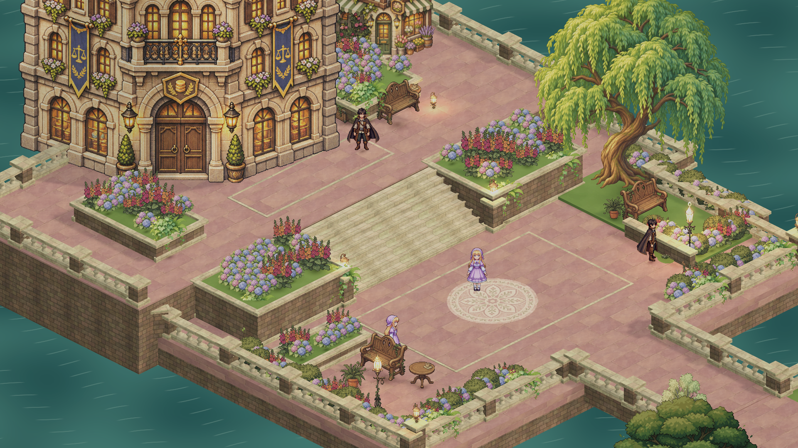
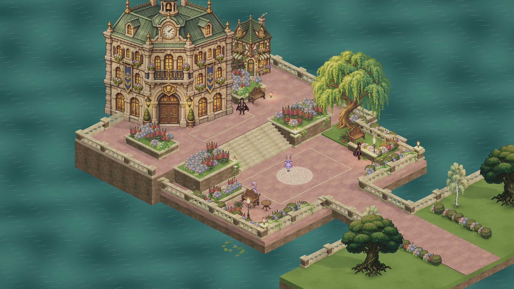

# Willow Court — 물가의 정원 앞뜰

2026-11-08 제작. 기존 광장 배치를 재사용하지 않고, 큰 건물 앞 테라스·계단·물가 산책로·다리·나무 그늘을 연결한 별도 구역이다.

## 열고 걸어 보기

- Scene: `Assets/_Project/Scenes/SquareScene_WillowCourt.unity`
- Unity에서 이 Scene을 열고 Play를 누른 후 Game view를 클릭한다.
- 기존 Player/Move 입력을 사용한다. WASD 또는 방향키, 게임패드 왼쪽 스틱으로 이동한다.
- 서버 로그인 없이 로컬 캐릭터로 구역을 걸을 수 있다.
- 계단을 올라 건물 앞 테라스로 가거나, 아래쪽 다리를 건너 남쪽 정원으로 이동할 수 있다.
- 카메라 각도는 고정이며 구역 안에서 캐릭터를 따라간다. 나무 뒤에서는 기존 Occluder 처리로 나뭇잎이 흐려진다.
- 편집은 Play mode를 종료한 뒤 한다.

## 공간과 에셋

- 1.54m 높이의 상단 테라스, 8단 계단과 연속 보행 경사면.
- 낮은 광장, 실물 3D 석조 화단, 조각된 난간, 수면 아래까지 내려가는 기초.
- 물가 다리와 남쪽 정원, 물결이 움직이는 URP Water Shader.
- 버드나무 그늘의 벤치, 별도의 작은 차 마시는 공간, 상단 건물 앞 휴식 공간.
- 새로 생성한 버드나무·수국·늘어지는 잎·장밋빛 포장·식물 문양 모자이크.
- 화단 안의 화분을 제거하고 꽃 높이와 분포를 달리했다. 벽을 타고 내려오는 잎과 바닥의 작은 이끼로 경계를 연결했다.

새 에셋, Material, Mesh, Shader, VolumeProfile, Editor 제작 코드는 `Assets/_Project/Art/WillowCourt/`에 모았다.
빌트인 `image_gen`으로 만든 이미지의 정확한 프롬프트와 재사용 에셋 목록은 같은 폴더의 `generation.json`에 기록했다.
레퍼런스 이미지는 구도와 공간 밀도만 참고했고 이미지의 픽셀을 복사해 사용하지 않았다.

## 편집할 곳

`Willow Court` 아래의 번호별 그룹에서 구조물·식재·가구·물을 수정할 수 있다.

| 그룹 | 내용 |
|---|---|
| 01 | 기초, 테라스, 계단과 보행 경사면 |
| 02 | 건물, 벽, 조각 난간 |
| 03 | 화단, 나무와 식재 |
| 04 | 벤치, 테이블, 조명 |
| 05 | 물, 다리, 남쪽 정원 바닥 |
| 06 | 꽃가루 효과 |
| 07 | 주변 인물의 시각적 배치 |
| 08 | 구역 경계 |
| 09 | 담쟁이, 모자이크, 잔디 경계와 수련 |
| 10 | 물가의 추가 난간 |

주변 인물은 현재 장식용 정지 Sprite이며 대화·행동 AI는 추가하지 않았다.
건물 내부 진입이나 문 상호작용도 추가하지 않았다.

## 실행 구조

- `WillowCourtEntry`: 이 Scene에서만 Input System 초기화 후 기존 Player를 활성화한다. Editor용 미리보기 캐릭터는 실행 시 숨긴다.
- `WillowCourtCamera`: 기존 카메라 각도를 유지하며 구역 안에서 부드럽게 추적한다.
- 기존 `PlayerMovement`, `CharacterSpriteView`, `Occluder`, Player Prefab 원본은 수정하지 않았다.
- 원본 `SquareScene`, `SquareScene_Garden`, 앞서 만든 `SquareScene_Healing`은 보존했다.
- 기존 네트워크·UI 오브젝트는 새 Scene에서 비활성 상태이며 서버에 자동 접속하지 않는다.
- Build Profiles 및 로그인 후 Scene 전환 대상은 변경하지 않았다.
- 시간대 조명 관리자는 이 Scene에서 비활성 상태다. 일정한 낮 조명으로 아트 검토와 로컬 탐색이 가능하다.
- Editor 제작 메뉴는 결과 Scene이 이미 존재하면 생성 작업을 거부한다. 결과물은 일반 Scene과 저장된 Mesh/Material이므로 실행 시 제작 코드에 의존하지 않는다.

## 검증

Unity 6000.6.6f1 Editor에서 확인했다.

- 컴파일 및 Play mode Console 오류 없음.
- Scene 검사: missing script 0, broken prefab 0.
- 기존 PlayerMovement에 가상 Gamepad 입력을 넣어 실제 Rigidbody 이동을 확인했다. 테스트 종료 후 가상 장치를 제거했다.
- 계단 오르기: (-1, 0.01, -3.20) → (-1, 1.55, 4.31).
- 계단 내려오기: (-1, 1.54, 4.75) → (-1, 0.01, -3.44).
- 다리 통행: (-0.55, 0.15, -7.50)에서 남쪽으로 이동하여 (-0.55, 0.05, -18.87)에 도착. 경로 최저 높이 0.01m.
- 다리 측면으로 계속 이동하는 검사: x=1.23에서 난간에 막혔고 y=0.085를 유지했다.
- 버드나무 뒤 가림 검사: 기존 OccluderFade Material로 전환되며 alpha=0.35 확인.
- Play mode 재진입 후에도 캐릭터가 활성 입력 Action을 참조하는 것을 확인했다.
- 넓은 화면 검토에서 뒤쪽 건물이 토대 밖에 있던 문제와 기초 면이 겹치던 부분을 수정했다.

이는 Editor의 시각·이동 검증이다. 목표 기기의 성능 측정, 배포 빌드, 로그인/멀티플레이 연결 검증은 수행하지 않았다.

## 실제 Unity 렌더

`game-camera.png`: 1920×1080, 기본 Orthographic Size 8.3.
`overview.png`: 전체 배치를 확인하기 위해 Size 13.25로 촬영한 뒤 원래 값으로 복구.

