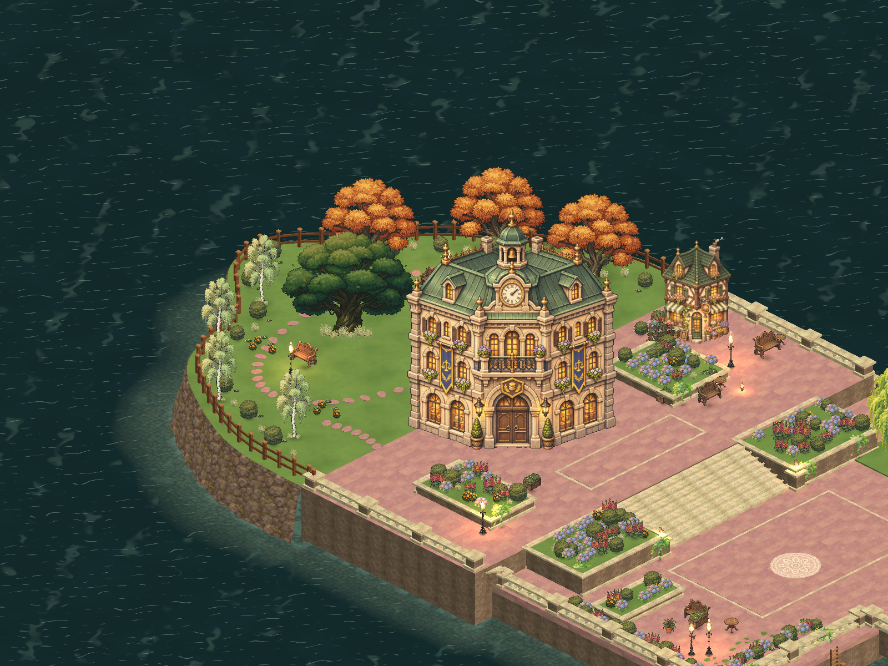
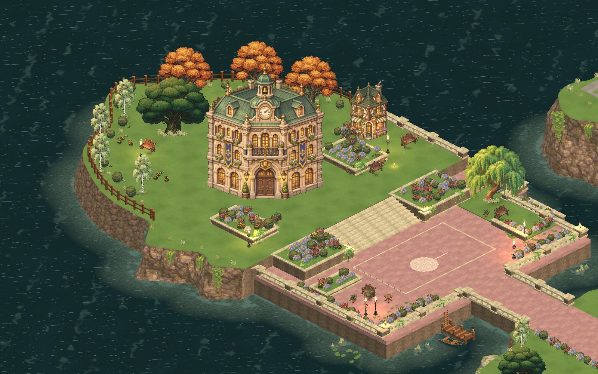

# Academy 북쪽 정원

실제 SquareScene 에셋을 게임과 같은 (30°, 45°) 각도의 임시 Camera로 렌더했다. 검토용 Camera는 Scene에 저장하지 않았다.

건물 위치를 유지한 채 북쪽 땅을 약 24.6m 확장했다. 곡선 해안, 잔디 정원, 식재와 나무 울타리를 추가했다. 제작·충돌 검증 기록은 `unity/Assets/_Project/Art/AcademyGarden/README.md`에 있다.

## Academy terrace 자연 지형 (2026-11-10)

테라스 바닥을 잔디로 바꾸고, 서쪽 석축과 난간을 풀밭 가장자리와 바위 절벽으로 바꿨다. 자세한 기록은 `unity/Assets/_Project/Art/AcademyGarden/README.md`에 있다.
